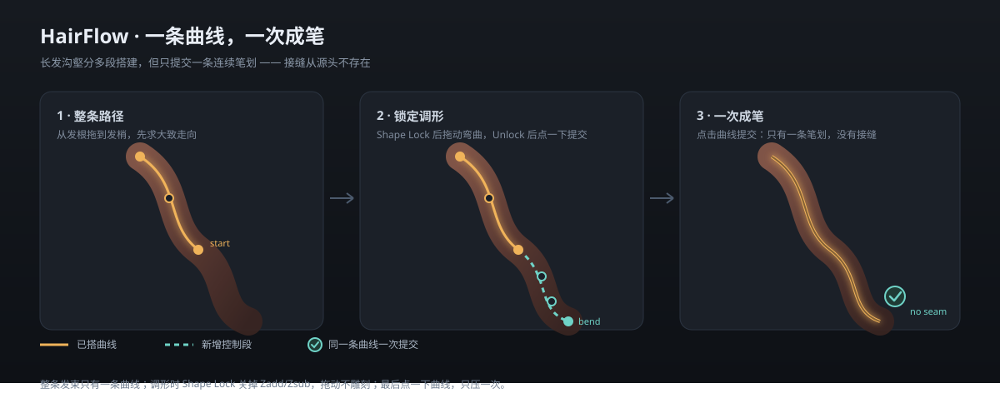

# HairFlow

**ZBrush 长发沟壑一笔贯通助手** · A ZBrush plugin for seam-free long hair grooves

适用 ZBrush 2022.0.5 / 2025.0.1（两版都已实测） · 纯 ZScript，无 DLL · MIT License



## 它解决什么

手办长发的一条沟常常从发根贯到发梢，手绘一笔画不完，分段接笔就会在接头处变浅、错位、出双线。

HairFlow 的思路：**不接笔，接曲线**。整条发束只用 ZBrush 原生 Curve 模式画一条曲线，调好形状后点一下，一次压出整条沟——没有第二笔，就没有接缝。笔刷的 Size / Z Intensity / Alpha 完全不动。

## 五步用法

1. **Remember Stroke** → **Long Strand Curve**（开曲线模式、贴面、关防抖、Curve Step 0.1）
2. 从发根**一次拖到发梢**（只生成曲线，不雕刻）
3. 要改形：**Shape Lock** → 拖曲线弯曲 → **Smooth Curve** → **Shape Unlock**
4. 曲线变红时**点一下**提交 → **Delete Curve**
5. **Restore Stroke** 还原你的设置

> 实测发现：Curve 模式下直接拖曲线，每次鼠标移动都会压一次，留下多排痕迹。Shape Lock 临时关掉 Zadd/Zsub，调形不留痕；Unlock 原样恢复。

## 安装

- 把 `plugin/HairFlow.zsc`（2025）或 `plugin/HairFlow_2022.zsc`（2022，改名为 `HairFlow.zsc`）放进 `ZBrush\ZStartup\ZPlugs64\`，重启 ZBrush，在 **ZPlugin > HairFlow** 找到面板。
- 或运行 `install/HairFlow_Install.bat`（默认路径见脚本参数，可改）。
- 2022 与 2025 的 `.zsc` 字节码不同，不能互换；改源码后用 ZScript > Load 重新编译 `plugin/HairFlow.txt`。

## 文档

| 文件 | 内容 |
|---|---|
| [docs/QUICK_REFERENCE.md](docs/QUICK_REFERENCE.md) | 一页速查 |
| [docs/README_zh.md](docs/README_zh.md) | 完整中文手册 |
| [docs/FAQ.md](docs/FAQ.md) | 常见问题 |
| [docs/VERIFICATION.md](docs/VERIFICATION.md) | 验证记录（含屏幕实测） |
| [docs/DESIGN.md](docs/DESIGN.md) | 设计取舍 |
| [docs/CHANGELOG.md](docs/CHANGELOG.md) | 版本历史 |

## 测试

```bash
python tests/check_hairflow.py        # 静态检查（不启动 ZBrush）
python tests/build_runtime_test.py    # 生成按钮命令体运行期测试
```

详见 [tests/README.md](tests/README.md)。

## English summary

HairFlow turns a long hair groove into **one** ZBrush Curve-mode stroke: draw the curve root to tip, bend it with *Shape Lock* on (Zadd/Zsub temporarily off, so dragging does not sculpt), *Shape Unlock*, then click the curve once. No seams, and your brush settings are untouched. Tested by hand in ZBrush 2022.0.5 and 2025.0.1.
