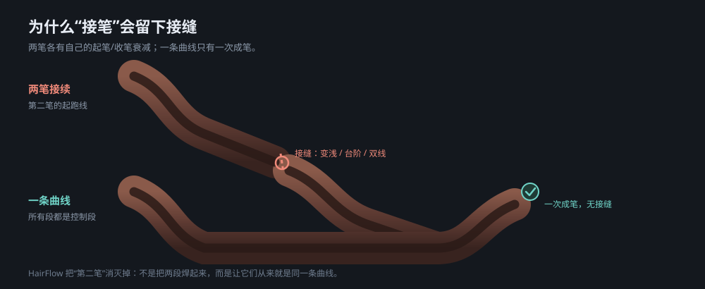

# HairFlow · 长发沟壑一笔贯通助手

版本 1.6.0 · 适用于 ZBrush 2022.0.5 / 2025.0.1（两版都已在本机屏幕实测）

> 说明：题目中的“205.0.0”按 **ZBrush 2025.0.0** 理解；本机实际为 **2025.0.1**。2022.0.5 与 2025.0.1 都已完成运行期 + 真实鼠标操作验证（见第 9 节）。

> **1.6.0 要点（屏幕实测得出）**：在 Curve Mode 里**拖动曲线本身就会雕刻**，每个鼠标移动都会压一次，调形会叠出多排痕迹。所以调形前先按 **Shape Lock**（临时关掉 Zadd/Zsub，Z 强度不动），调完 **Shape Unlock** 原样恢复，再**在曲线上点一下**提交。另外 Curve Step 0.25 下 DamStandard 的沟呈珠串状，Long Strand Curve 现在直接设为 0.1。

> **1.5.0 修正回顾**：1.2–1.4 的 Long Strand Curve 写的是 `Stroke:Curve`（子面板），没有打开 Curve Mode；Add Curve Point 按到的是 `Stroke:Inventory:Add`。详见 [CHANGELOG.md](CHANGELOG.md)。

---

## 30 秒快速开始

1. 选好发沟笔刷，点 **Remember Stroke**；
2. 点 **Long Strand Curve**（Curve Mode 开、Lazy 关、Snap 开、Step 0.1）；
3. 从发根到发梢**拖出一条曲线**（这一步只画路径，不雕刻）；
4. 要改形状：**Shape Lock** → 拖动曲线弯曲 → **Smooth Curve** → **Shape Unlock**；
5. **在曲线上点一下**提交（一次）→ **Delete Curve** → **Restore Stroke**。

> 不要画两笔再接：整条发束只用**一条曲线**。没有 Shape Lock 就直接拖曲线，会在模型上叠出多排痕迹。

> 需要打印/贴屏幕边：看 [QUICK_REFERENCE.md](QUICK_REFERENCE.md)。

## 目录

- [1. 它解决什么问题](#1-它解决什么问题)
- [2. 安装](#2-安装)
- [3. 界面与核心功能](#3-界面与核心功能)
- [4. 长发沟壑标准流程](#4-长发沟壑标准流程推荐)
- [5. 参数配置](#5-参数配置)
- [6. 为什么能保留手感和细节](#6-为什么能保留手感和细节)
- [7. 兼容性约束](#7-兼容性约束)
- [8. 异常处理](#8-异常处理)
- [9. 验证方式与结果](#9-验证方式与结果)
- [10. 文件清单](#10-文件清单)
- [11. 一句话总结](#11-一句话总结)

## 1. 它解决什么问题

日式手办的长发发束常常一条沟壑从发根贯到发梢。用自由手绘时，一笔画不到底，只能分 2–4 段接续；接缝处容易出现：

- 起笔变浅、收笔变尖，形成“蜂腰”；
- 两段方向/宽度略偏，出现台阶或双线；
- 反复补笔把沟壑压平，细节和锐度丢失。

HairFlow 的思路不是“把两段笔划焊在一起”，而是 **让整条发束始终只有一条曲线、最后一次成笔**：

> 用 ZBrush 原生 **Curve Mode** 先拖出整条发束的路径，再一段一段地弯曲、贴面、修顺；确认形态后点击曲线一次提交。  
> 因此不存在“接缝”，沟壑的深浅、Alpha、笔刷细节完全由当前笔刷决定。

这比“画两段再补缝”更接近手办头发的真实制作逻辑：先定发流，再压沟。



---

## 2. 安装

### 2.1 ZBrush 2025.0.1（已自动安装）

本机已安装：

```
D:\media work\Zbrush2025.0.1\ZStartup\ZPlugs64\HairFlow.zsc   (1.6.0, 2025 编译, 16376 字节)
D:\media work\Zbrush2025.0.1\ZStartup\ZPlugs64\HairFlow.txt   (1.6.0 源码)
```

启动 ZBrush 后，在右侧 **ZPlugin** 面板底部找到 **HairFlow** 子面板。

> ZBrush **只加载 `ZPlugs64` 里的 `.zsc`**，放进去的 `.txt` 不会被自动编译（实测）。改源码后需要重新编译，见 2.2。

### 2.2 ZBrush 2022.0.5（已自动安装）

```
D:\media work\ZBrush 2022.0.5\ZStartup\ZPlugs64\HairFlow.zsc   (1.6.0, 由 2022 自己编译, 49204 字节)
D:\media work\ZBrush 2022.0.5\ZStartup\ZPlugs64\HairFlow.txt   (1.6.0 源码)
```

2022 和 2025 的 `.zsc` 字节码不同（同一份源码分别为 49204 / 16376 字节），安装脚本会给每个版本装它自己编译的那份（包内 `plugin/HairFlow_2022.zsc`）。

只有改了源码才需要重新编译：ZScript → Load → 选 `ZPlugs64\HairFlow.txt` → 重启。

> 本机 2022 只在 **2025 同时开着**时报过 “Unable To Open File” 并退出；先关掉 2025 再启动 2022 即正常。

> 也可双击 `install\HairFlow_Install.bat` 重新复制两个版本的文件（不会覆盖用户工程）。
> 若系统禁止运行脚本，请用 bat 包装器，或对当前会话使用 `-ExecutionPolicy Bypass`。
> 安装脚本把旧文件备份到 **ZBrush 根目录** 的 `_hairflow_backup_*`，不放进 `ZPlugs64`，避免被 ZBrush 当成第二个插件加载。

### 2.3 数据目录

插件诊断文件写入：

```
C:\HairFlow\HairFlow_diag.txt
```

安装脚本会自动创建该目录。

---

## 3. 界面与核心功能

| 按钮 | 作用（原生路径） | 说明 |
|---|---|---|
| **Preflight Check** | 检查 SubTool / Edit / Shape Lock / Curve Mode / Curve Step | Shape Lock 未解除、Step > 1 都会提醒 |
| **Long Strand Curve** | `Stroke:Curve:Curve Mode`=1，Lazy Mouse=0，`Stroke:Curve:Snap`=1，Curve Step=0.1 | 长发沟壑主模式 |
| **Curve Off** | Curve Mode=0，Lazy 状态不变 | 回到普通笔划 |
| **Curve Edit Tips** | 只显示提示，不改任何设置 | 提醒：拖曲线会雕刻，先 Shape Lock |
| **Shape Lock** | 记住并关闭 `Draw:Zadd` / `Draw:Zsub` | 调形期间拖曲线不雕刻；Z 强度、Size、Alpha 不动；重复按不会覆盖记住的值 |
| **Shape Unlock** | 把 Zadd/Zsub 恢复成 Lock 前的样子 | 之后在曲线上点一下提交；Restore / Reset 也会自动解锁 |
| **Smooth Curve** | 按原生 笔触 > 曲线函数 > 平滑 | 只修曲线，不雕刻（实测） |
| **Delete Curve** | 按原生 笔触 > 曲线函数 > 删除 | 提交后清理曲线；曲线虚线会遮住沟，删掉才看得清 |
| **Curve Step（滑杆）** | 0–2，精度 0.05，默认 0.25 | 越小越密越顺；拖动即写入原生 Curve Step |
| **Step Fine / Standard / Medium / Fast** | Curve Step = 0.1 / 0.25 / 0.5 / 1 | 同步更新滑杆；发沟推荐 Fine（实测 0.25 呈珠串） |
| **Curve Snap On / Curve Snap Off** | `Stroke:Curve:Snap` | 头发沟壑通常保持 ON |
| **Freehand Assist** | Curve Mode 关；Lazy 开，Radius 10 / Step 0.25 / Smooth 4 | 仅在你坚持自由手绘时使用 |
| **Remember Stroke** | 记住 Curve Mode / Curve Step / Snap / Lazy 四项 | 不改笔刷大小、强度、Alpha |
| **Restore Stroke** | 回到 Remember 时的状态（滑杆同步） | 未 Remember 时只提示，不写入 |
| **Reset Stroke Defaults** | Curve 关、Step 0.25、Snap 关、Lazy 1 / 0.25 / 0 | 2025.0.1 启动实测值；Lazy 开关按笔刷而定，不改 |
| **Open Manual** | 打开 `C:\HairFlow\docs\README_zh.md` | 缺失时重跑安装 |
| **Open Data Folder** | 打开 `C:\HairFlow` | 查看 `HairFlow_diag.txt` |
| **Diagnostics** | 写 4 行状态报告（含 Zadd/Zsub/锁状态） | 写入成功/失败都会提示 |
| **Workflow** | 显示四步流程 | 状态栏提示 |

> 插件**不修改** Draw Size、Z Intensity、Focal Shift、Imbed、Alpha、Brush 类型。  
> 因此沟壑深浅、边缘锐度、发丝细节都保持你原本的笔刷手感。

### 3.1 术语表

| 术语 | 含义 | 在本插件里 |
|---|---|---|
| Curve Mode | Stroke > Curve 子面板里的开关：先有路径，再沿路径成笔 | Long Strand Curve 开启 |
| Curve Step | 沿曲线的笔刷点间距（原生 0–10，默认 0.25），越小越密 | 滑杆 + 四档预设 |
| Snap | 曲线是否贴合模型表面 | Snap On/Off |
| Lazy Mouse | 延迟跟随，降低手抖，但会让路径滞后 | Freehand Assist 使用 |
| Commit | 点击曲线线条，把当前路径写成一条笔划 | 第 4 步 |

---

## 4. 长发沟壑标准流程（推荐）

### 第 0 步：准备笔刷

选择你平时做发沟的笔刷（例如 DamStandard、Crease、或自定义发丝笔刷），调好：

| 你想要的效果 | 主要旋钮 | 经验 |
|---|---|---|
| 沟更宽/更窄 | Draw Size | 笔刷直径 ≈ 目标沟宽 × 1.2–1.5，留一点边缘余量 |
| 沟更深/更浅 | Z Intensity、Imbed | 先低后加；同一条发束中途不要改 |
| 边缘更锐/更柔 | Focal Shift、Alpha | 负 Focal 更锐；软 Alpha 更柔；同一条发束保持一致 |
| 发丝质感 | Brush 类型 | 中途不要换笔刷 |

先点 **Remember Stroke**，保存当前 Curve / Lazy 状态。

### 第 1 步：进入长发模式

点 **Long Strand Curve**。此时（2022 / 2025 屏幕确认）：

- 笔触 > 曲线 > **曲线模式**（Curve Mode）亮起，**捕捉**（Snap）亮起；
- Lazy Mouse 关闭（避免二次延迟把曲线拉弯）；
- Curve Step = 0.1（DamStandard 类细沟在 0.25 下会呈珠串）。

### 第 2 步：拖出整条路径

从发根**一次拖到发梢**。这一步只生成曲线（虚线），**不会雕刻**。曲线末端会像拉绳一样略滞后于鼠标，拖得比目标稍长一点。

> 发束太长、一屏放不下：先缩小视图把整条发束放进屏幕再拖。ZBrush 不能“接长”一条已有曲线——拖端点是把整条曲线拖走（实测）。

### 第 3 步：调形（关键：先锁）

实测：Curve Mode 下**拖动曲线会在每个鼠标移动时压一次笔划**，没锁就调形，会在旧位置留下多排点状痕迹。所以：

1. 点 **Shape Lock**（Zadd/Zsub 关闭，状态栏提示）；
2. 光标靠近曲线，出现红色高亮和编辑圈后**拖动**，曲线随之弯曲；可多处、多次调；
3. 点 **Smooth Curve** 1–3 次修顺；
4. 点 **Shape Unlock**（Zadd/Zsub 原样恢复——DamStandard 在 2022 默认是 Zsub，也会正确恢复）。

**曲线手势速查（实测）**

| 手势 | 结果 |
|---|---|
| 在发束上从根拖到梢 | 生成曲线，不雕刻 |
| 拖曲线中段（未锁） | 弯曲/移动曲线，**同时**每次移动压一次 → 多排痕迹 |
| 拖曲线中段（Shape Lock） | 只改形状，不雕刻 |
| 拖曲线端点 | 整条曲线被拖走（不是延长）；未锁时同样会压笔划 |
| Smooth Curve | 放松折点，不雕刻 |
| 在曲线上点一下 | 沿曲线压**一次**笔划（提交） |
| Delete Curve | 删除曲线（模型保留） |
| Ctrl+Z | 一次撤销整次提交（含拖动造成的叠加） |

### 第 4 步：提交

- 确认 Shape Lock 已解除（Preflight 会提醒）；
- 光标移到曲线上，等它变红高亮，**点一下**：沿曲线压出一条连续、两端自然收尖的沟；
- 点 **Delete Curve** 清理（曲线虚线会遮住刚压出的沟，删掉才看得清）。

> 实测细节：完全静止的“合成点击”不会提交，按下后哪怕移动 1 像素就会提交。真人点击天然带微小位移，正常点即可；若偶尔点了没反应，按住轻轻一动再松开。

> 笔触 > 曲线函数 > **快照**（Snapshot）官方说明是“把曲线的雕刻应用到模型，曲线可再调整后再次快照”。本机测试时该按钮在 DamStandard 下是禁用（灰色）状态，按了无效；插件不依赖它。

### 第 5 步：恢复

点 **Restore Stroke**，回到你原来的 Curve / Step / Snap / Lazy 设置（若忘了 Shape Unlock，它会顺便解锁）。

---

## 5. 参数配置

### 5.1 Curve Step

沿曲线的笔刷点间距。ZBrush 原生范围 0–10，**默认 0.25**；数值越小点越密、沟越顺，也越慢。

| 预设 | 值 | 适用 |
|---|---|---|
| Step Fine | 0.1 | **发沟推荐**（Long Strand Curve 默认）；连续顺滑 |
| Step Standard | 0.25 | ZBrush 默认；DamStandard 细沟实测呈珠串，软笔刷可用 |
| Step Medium | 0.5 | 粗发束、快速调形 |
| Step Fast | 1 | 大形铺设；小笔刷上可能看到点状 |

经验规则：

- Step 只影响**提交那一下**的点密度；调形期间（Shape Lock）不雕刻，所以调形卡不卡与 Step 关系不大；
- 提交卡顿可临时换 Medium，但要检查点状；不要为了性能把同一条发束拆成两条曲线；
- 超过 1 后笔刷点之间可能断开，沟里出现“珠串”——Preflight 会提醒。滑杆上限因此设为 2，需要更大值请直接用 Stroke 面板。

### 5.2 Curve Snap

- ON：曲线贴在模型表面，适合发束正面沟壑；
- OFF：曲线悬浮，适合调整轮廓/发梢飘逸感。

### 5.3 Freehand Assist（备用）

如果你坚持自由手绘分段：

- Lazy Mouse ON，Radius 10，Step 0.25，Smooth 4（原生 Lazy Smooth 上限 16）；
- 第二段起笔重叠上一段 10–15%；
- 保持 Z Intensity / 手压稳定；
- 接缝处按住 **Shift**，用 Smooth 笔刷轻扫 2–3 次（不要用力，避免压平沟底）。

这只是“降低接缝可见度”，不如 Curve 方案彻底。

### 5.4 不建议修改的参数

- **Draw Size**：改了会改变沟壑宽度；
- **Z Intensity / Imbed**：改了会改变深度；
- **Alpha / Focal Shift**：改了会改变边缘细节；
- **Brush 类型**：换笔刷会改变整体质感。

HairFlow 只动 Stroke 状态，不动这些。

---

## 6. 为什么能保留手感和细节

1. **同一条笔刷**：全程使用你当前选中的笔刷，不切换、不复制。
2. **同一条笔划**：Curve 提交时 ZBrush 只做一次连续笔划计算，没有“第二笔”的起笔/收笔衰减。
3. **同深度**：Z Intensity、Imbed、Alpha 不变，沟底深度与单笔一致。
4. **同细节**：Focal Shift、Alpha 边缘不变，发丝锐边不被补笔磨平。
5. **可逆**：Remember / Restore 只恢复 Stroke 状态；ZBrush 自身 Undo 可回退提交。

### 6.1 插件不做什么

- **不自动焊接两段自由笔划**：整条发束只有一条曲线，从机制上避免接缝；
- **不修改笔刷参数**：Draw Size、Z Intensity、Focal Shift、Imbed、Alpha 都不动；
- **不导出/导入网格**：不碰拓扑、UV、SubTool；
- **不接管 Undo**：提交后用 ZBrush 自身 Undo；
- **不常驻后台**：纯 ZScript UI，无外部进程、无 DLL。

> 为什么不做自动焊接，见 [DESIGN.md](DESIGN.md) 第 2 节。

---

## 7. 兼容性约束

| 项目 | 2022.0.5 | 2025.0.1 | 说明 |
|---|---|---|---|
| 插件加载 | 自动加载（2022 自编译 `.zsc`） | 自动加载 | `.txt` 不会自动编译 |
| 原生路径身份（12 条） | 实测一致 | 实测一致 | `IGetTitle` 解析 |
| 22 按钮命令体回读 | 实测通过 | 实测通过 | 两版输出逐行相同 |
| 真实鼠标：滑杆、Shape Lock 调形、点击提交 | 实测通过 | 实测通过 | 屏幕操作 |
| 中文界面 | 无 | 无 | 插件为 ASCII 英文标签，避免 ZScript 编译器吞非 ASCII |
| 高模性能 | 取决于 Curve Step | 同左 | 52 万面球体上 Fine 提交无明显卡顿；更高面数自测 |

其他约束：

- Curve 依附于 **PolyMesh3D**，请先确保模型已进入 Edit 模式；
- 开始新曲线会替换旧曲线；提交前不要在其他位置起笔；
- 曲线是“当前笔划”的编辑状态，切换工具/SubTool 后可能丢失，属 ZBrush 原生行为；
- 插件不做网格导出/导入，不会破坏拓扑或 UV。

### 7.1 性能与长曲线

Curve 的成本大致随“曲线长度 ÷ Curve Step”增长：每次调整，ZBrush 都会重算整条曲线上的笔刷点。

| 发束长度 | 建议 Step | 策略 |
|---|---|---|
| < 2 个头长 | Fine | 直接提交 |
| 2–4 个头长 | Fine | 提交慢可隐藏无关 SubTool |
| > 4 个头长 | Fine，必要时 Standard | 用 Standard 时检查珠串；不要把同一条发束拆成两条曲线 |

卡顿时按顺序尝试：

1. 隐藏不相关 SubTool；
2. 提交时临时用 **Step Standard / Medium**，提交后检查点状；
3. 提交后 **Delete Curve**；
4. 仍卡：降低 Draw Size 或分段做**不同发束**（不是同一条发束的接续）。

---

## 8. 异常处理

### 8.0 快速定位

| 症状 | 最可能原因 | 先做什么 |
|---|---|---|
| ZPlugin 里没有 HairFlow | `.zsc` 缺失或是另一版本编译的 | 重跑安装脚本；`Verify-HairFlow.ps1` 会核对两版 `.zsc` |
| 点模式按钮没反应 | 无 SubTool / 非 Edit | 先点 **Preflight Check** |
| 点了 Long Strand Curve 但画的还是普通笔划 | 用的是 1.4 及更早版本 | 升级（旧版写的是子面板，不是 Curve Mode） |
| 调形后模型上多了几排点 | 没锁就拖了曲线 | Ctrl+Z；先 **Shape Lock** 再拖 |
| 点曲线后什么也没压出来 | Shape Lock 没解除 / 点击完全静止 | **Shape Unlock**（Preflight 会提示）；按住轻轻一动再松开 |
| 笔刷画什么都没效果 | 忘了 Shape Unlock | **Shape Unlock** 或 **Restore Stroke** |
| 画不出曲线 | 非 3D 笔刷 / 光标不在模型表面 | 换雕刻笔刷，在模型上拖一段 |
| 调形后出现折角 | 拖动幅度大 / 未 Smooth | **Smooth Curve** 1–3 次 + **Snap On** |
| 沟里有一颗颗的点 | Curve Step 太大 | **Step Fine** |
| 提交后沟比预期深一倍 | 点了两次曲线 | Ctrl+Z，只点一次 |
| 长曲线很卡 | Step 太小 / 曲线太长 | **Step Medium**，隐藏无关 SubTool |
| 点击曲线没提交 | 点偏 / 曲线已失效 | 点在曲线线条上；失效就重搭 |

### 8.1 点 Long Strand Curve 没反应

- 展开 Stroke > Curve 子面板，确认 **Curve Mode** 亮起；
- 确认当前是 3D 雕刻笔刷（不是 Move/Transpose）、模型在 Edit 模式；
- 若某个路径在你的版本里不存在，插件会提示，手动在 Stroke > Curve 子面板操作即可。

### 8.2 曲线画不出来 / 一点就消失

- 光标必须在模型表面；
- 笔刷不能是 2.5D 笔刷；
- 要拖出一段，不要只单击。

### 8.3 点击曲线没有提交

- 先看 Shape Lock 是否还开着（状态栏 / Preflight）；
- 光标要在曲线线条上，曲线变红高亮时再点；
- 完全不动的点击不会提交，按下后轻轻一动再松开；
- 若已切换到其他笔刷/工具，曲线可能已失效，需要重搭。

### 8.4 接缝仍然可见（自由手绘模式）

- 这是自由手绘的固有问题，改用 **Long Strand Curve**；
- 或把重叠区扩大到 15%，并用 Shift+Smooth 轻扫。

### 8.5 插件面板不出现

- 确认 `HairFlow.zsc` 在 `ZStartup\ZPlugs64`；
- 2022 和 2025 的 `.zsc` 不能互换，用安装脚本装各自的版本；
- 重启 ZBrush；检查是否有同名旧插件冲突。

### 8.6 本机 2022 启动报 “Unable To Open File”

本机实测：2025 正在运行时启动 2022 会报此错并退出（或一秒内退出）；关掉 2025 后 2022 正常启动、插件正常加载。之前把它判断为“2022 安装损坏”是错的。

> 更多问答见 [FAQ.md](FAQ.md)。

---

## 9. 验证方式与结果

详见 [VERIFICATION.md](VERIFICATION.md)；手工验收清单 [ACCEPTANCE.md](ACCEPTANCE.md) 的核心项已由屏幕操作完成。摘要（2022.0.5 与 2025.0.1 都做了）：

- **路径身份**：12 条原生路径全部用 `IGetTitle` 解析到预期控件，两版一致；
- **按钮行为**：从 `HairFlow.txt` 原样抽取 19 步按钮命令体执行回读，两版输出逐行相同；Shape Lock 重复按不丢原值，Unlock / Restore 精确恢复，Z 强度始终不变；
- **真实鼠标**：拖滑杆 → 原生 Curve Step 同步；四个 Step 预设同步；Long Strand Curve 点亮曲线模式与捕捉；Shape Lock 下多步拖动调形无痕；Unlock 后点一下曲线 → 一条连续、两端收尖的沟；Delete / Restore 正常；
- **自动加载**：两版都从 ZPlugs64 加载各自编译的 `.zsc`，22 按钮 + 滑杆存在。

---

## 10. 文件清单

```
HairFlow/
  plugin/
    HairFlow.txt          插件源码（ASCII）
    HairFlow.zsc          2025 编译产物（16376 字节）
    HairFlow_2022.zsc     2022 编译产物（49204 字节）
  install/
    HairFlow_Install.ps1  安装/备份脚本
    HairFlow_Install.bat  双击运行包装器
    Verify-HairFlow.ps1   安装文件校验
  docs/
    README_zh.md          本文件
    DESIGN.md             设计说明与技术取舍
    VERIFICATION.md       验证记录
    ACCEPTANCE.md         手工验收清单
    FAQ.md                常见问题
    QUICK_REFERENCE.md    一页速查
    CHANGELOG.md          版本历史
    ITERATIONS.md         迭代记录
    workflow.svg          工作流示意
    seam-comparison.svg   两笔接续 vs 一条曲线对比
  tests/
    check_hairflow.py     静态检查（含原生路径白名单）
    build_runtime_test.py 从源码生成按钮命令体运行期测试
    probe_ui.txt          UI + 路径身份探针
    results/              探针结果与屏幕截图归档
```

---

## 11. 一句话总结

**不要接笔，要接曲线。**  
HairFlow 把“长发分几段画”变成“同一条曲线锁住调形”，最后一次成笔——接缝从源头上不存在，笔刷的深度和细节原样保留。
